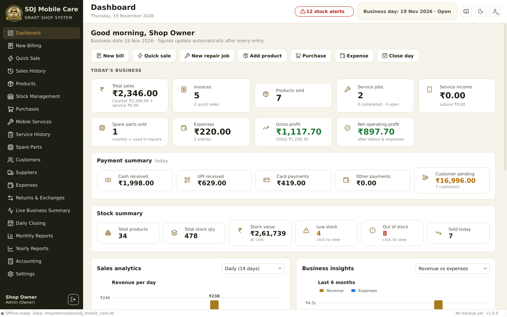
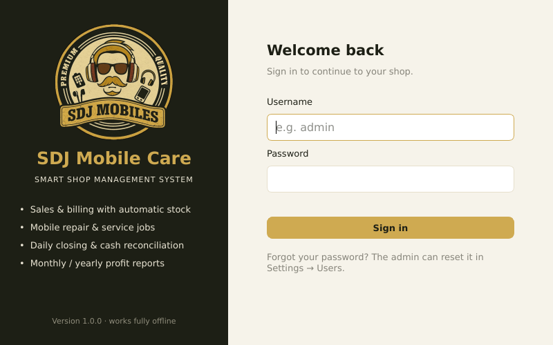
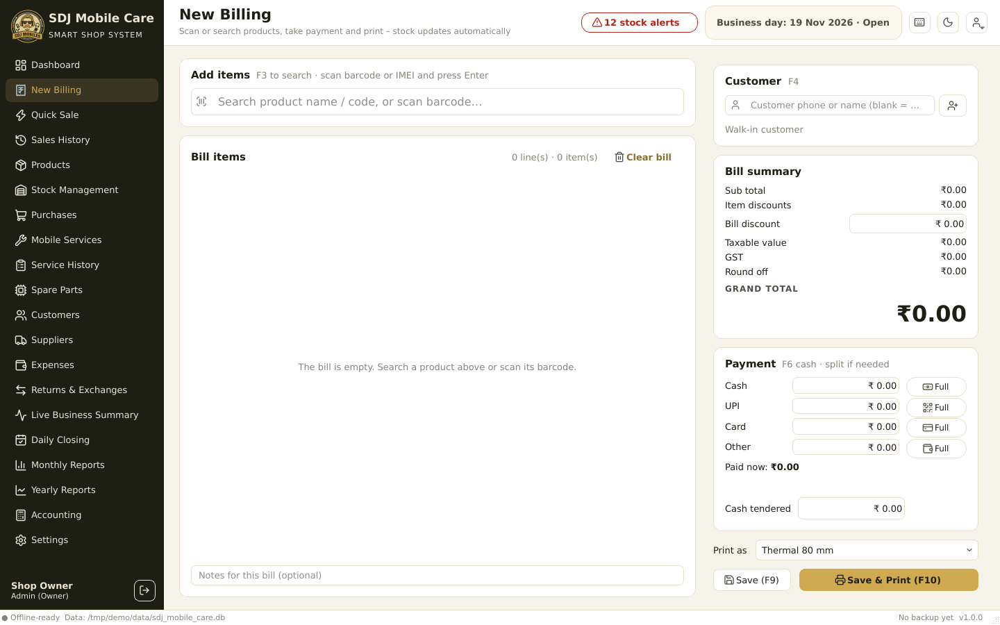
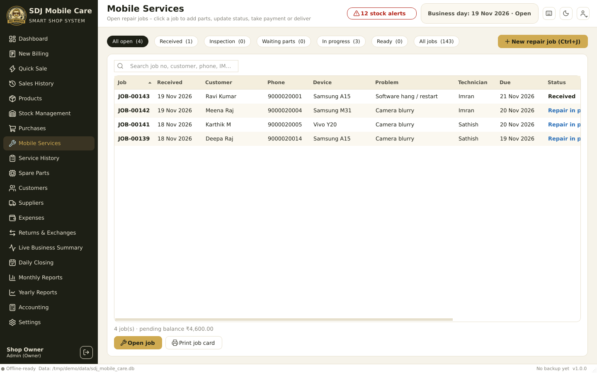
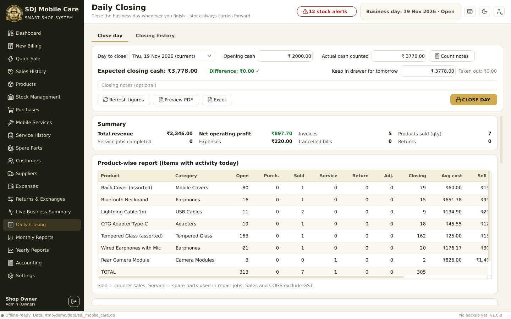
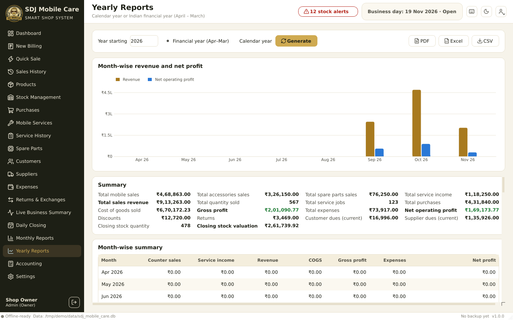
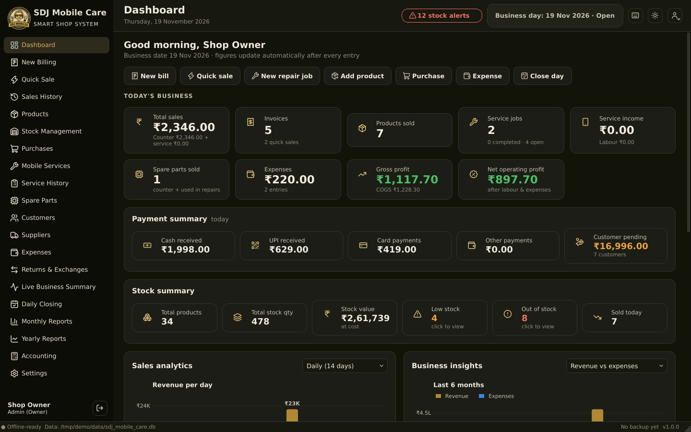

# SDJ MOBILE CARE – SMART SHOP MANAGEMENT SYSTEM

A complete, offline-first Windows desktop ERP for **SDJ Mobile Care**: mobile phone sales, accessories,
spare parts, repair & service jobs, automatic stock, billing, daily closing with cash reconciliation,
monthly / yearly reports, customers, suppliers, expenses, IMEI & warranty tracking and business analytics.

The owner only enters **products, purchases, sales, service jobs, payments and expenses**.
Stock deduction, sales totals, product-wise quantities, remaining stock, revenue, profit, service reports,
daily closing and monthly reports are all calculated automatically from those entries.



| | |
|---|---|
|  |  |
|  |  |
|  |  |

All 20 screens are in `docs/screenshots/`. Printed documents generated from the sample data are in
`docs/sample_documents/` (A4 invoice, 80 mm and 58 mm receipts, job card, service bill, daily closing and monthly reports).

---

## 1. What is inside

| Module | What it does |
|---|---|
| **Dashboard** | Today's sales, invoices, products sold, service jobs & income, spare parts sold, expenses, gross & net operating profit; cash / UPI / card / other / customer dues; stock summary; 7 graphs (daily, weekly, monthly, revenue vs expenses, top products, service income, profit); recent transactions; quick actions |
| **New Billing (POS)** | Product search, barcode scan, IMEI scan, multi-item bills, item & bill discounts, GST (inclusive / exclusive, CGST + SGST), round-off, cash / UPI / card / other, split, partial and credit payments, 58 mm / 80 mm thermal and A4 invoices, PDF, UPI "scan to pay" QR |
| **Quick Sale** | Product → quantity → price → payment mode → Save. Stock, revenue and profit update instantly |
| **Sales History** | Search by invoice, customer, phone, product or IMEI; view, reprint, collect dues, cancel (same open day) or return |
| **Products** | Mobiles, accessories, spare parts with every field from the spec, your own categories, Excel import / export, IMEI & warranty tracking, warranty claims |
| **Stock Management** | Live stock & valuation (weighted average cost), low / out-of-stock alerts, full movement history, authorised adjustments with reason |
| **Purchases** | Supplier invoices with GST, discount, freight (landed cost), IMEI entry, part payments; cancel if stock is still there |
| **Mobile Services** | Job intake & job card, status (Received → Inspection → Waiting for parts → In progress → Ready → Delivered / Cancelled), spare parts used (stock deducted immediately), labour, advance, delivery & service bill, repair warranty |
| **Service History** | All jobs + daily / weekly / monthly / yearly service reports and technician-wise performance |
| **Spare Parts** | Spare stock and consumption (repairs + counter sales) |
| **Customers / Suppliers** | Purchase & repair history, ledgers, pending balances, FIFO payment collection / supplier payments |
| **Expenses** | Rent, electricity, salary, transport, food, internet, maintenance, packaging, miscellaneous (editable list); edit / void with audit |
| **Returns & Exchanges** | Full / partial returns, refunds, exchanges, damaged goods, credit notes – always linked to the original invoice |
| **Live Business Summary** | Everything for the open business day, updated live, without closing the day |
| **Daily Closing** | Owner-controlled *Close Day* at any time: product-wise, category, service, financial, payment report, cash reconciliation, closing stock; PDF + Excel; record locked; audited reopen |
| **Monthly / Yearly Reports** | All totals, product-wise and service-wise reports, payment breakdown, dues, closing stock & valuation; calendar or Indian financial year; PDF / Excel / CSV |
| **Accounting** | Profit & loss, GST summary, customer dues with ageing, supplier dues, cash & bank book, stock valuation |
| **Settings** | Shop details & logo, invoice numbering, GST, printers, backups / restore, stock & service defaults, product categories (add / rename / hide), staff accounts & roles, password, light / dark theme, audit log |

---

## 2. Install and run on Windows 10 / 11

### Option A – Windows app (recommended)
1. Download `SDJMobileCare_Setup_1.1.0.exe` from the repository's **Releases** page (or build it yourself – see section 7).
2. Run `SDJMobileCare_Setup_1.1.0.exe` (installer) – or open `dist\SDJMobileCare\SDJMobileCare.exe` directly.
3. On the **first start** a short setup asks for the shop details (leave blank whatever you don't have yet – nothing is
   invented) and creates the **owner / admin login**.

### Option B – run from source (Python)
```bat
pip install -r requirements.txt
python main.py
```
`run_app.bat` does the same with a double-click.

### Try it with sample data first
```bat
python main.py --demo        (or run_demo.bat, or the "SDJ Mobile Care (demo data)" Start-menu shortcut)
```
The demo uses `sample_data/sdj_sample.db` – 60 days of made-up activity – in a **separate folder**, so it never mixes
with real shop data. Demo logins: **admin / admin123** (owner) and **staff / staff123** (sales staff).

---

## 3. Daily use in 6 steps

1. **Morning** – open the app; the business day opens automatically with yesterday's closing cash as opening cash.
2. **Selling** – *Quick Sale* for one item, *New Billing* for multi-item bills, credit or part payments. Scan barcodes / IMEIs
   or type the product name. Stock is deducted the moment you save.
3. **Repairs** – *Mobile Services → New repair job* prints a job card. Open the job to add spare parts (stock is deducted),
   set labour, take advance, mark *Ready*, then *Deliver & collect* and print the service bill.
4. **Buying stock** – *Purchases*: pick the supplier, add items (enter IMEIs for phones), save. Stock and average cost update.
5. **Expenses** – add tea, transport, rent, salary… with payment mode.
6. **Night** – *Daily Closing*: check the report, count cash (the *Count notes* helper adds up ₹500/₹200/… notes), enter how much
   stays in the drawer, press **CLOSE DAY**. A PDF report is saved and a backup is taken. Stock carries forward.

**Keyboard shortcuts:** `Ctrl+B`/`F2` New bill · `Ctrl+K` Quick sale · `Ctrl+J` New repair job · `Ctrl+D` Dashboard ·
`Ctrl+P` Products · `Ctrl+E` Expenses · `Ctrl+L` Live summary · `F5` Refresh · `F1` all shortcuts.
In billing: `F3` search/scan · `F4` customer · `F6` cash · `F9` save · `F10` save & print · `Ctrl+Delete` clear.

---

## 4. How the numbers are calculated (accounting engine)

All money is stored exactly (integer paise) – no rounding drift. All figures below exclude GST.

| Figure | Formula |
|---|---|
| Net counter sales | Gross sales − Discounts − Sales returns (+ round-off) |
| Net sales (goods) | Net counter sales + Spare parts used in completed repairs |
| Cost of goods sold | Weighted-average cost of goods sold − cost of restocked returns + cost of parts used in completed repairs |
| Gross profit | Net sales − COGS |
| Service income | Labour + spare-parts revenue (each counted **once**) |
| Spare parts profit | Spare-parts revenue − spare-parts cost |
| **Net operating profit** | Gross profit + Service labour income − Operating expenses |

* **Weighted average cost**: every purchase updates the product's average cost (landed: price + freight − discount,
  + GST when the shop is not GST-registered). Sales are costed at the average at that moment.
* **Service jobs**: parts leave stock when added to a job; labour and parts revenue/cost are booked on the day the job is
  marked *Ready* or *Delivered*, so spare-parts revenue can never be counted twice.
* **Damaged returns** are not put back into sellable stock; their cost stays in COGS as a loss and is listed separately.
* Sales revenue, payment collections, customer credit, supplier dues and GST are kept in separate records.
* **Duplicate protection**: every bill/job/purchase/return carries a one-time reference; a stock movement can only be
  applied once per document line (database constraint). Double-clicking *Save* cannot create a second bill.
* **Negative stock** is impossible through sales; only an authorised stock adjustment (owner/manager, with reason, audited)
  can add stock.

---

## 5. Data, security and backups

| Item | Location (Windows) |
|---|---|
| Database | `%LOCALAPPDATA%\SDJ Mobile Care\data\sdj_mobile_care.db` |
| Logs | `%LOCALAPPDATA%\SDJ Mobile Care\logs` |
| Invoices, reports, exports | `Documents\SDJ Mobile Care\Invoices`, `Reports`, `Exports` |
| Backups | `Documents\SDJ Mobile Care\Backups` (changeable in Settings) |

* SQLite with foreign keys, write-ahead logging and atomic transactions (a sale either saves completely or not at all).
* Financial records (sales, payments, purchases, returns, stock movements, expenses, service jobs, closings, audit log)
  **cannot be deleted** – database triggers block it. Mistakes are corrected by cancel / void / return, with a reason.
* Closed days are **locked**; only an admin can reopen a day, with a written reason that goes into the audit log.
* Passwords are stored as salted PBKDF2-SHA256 hashes. Roles: **Admin (owner)**, **Manager**, **Sales staff**, **Technician**
  (staff and technicians never see cost or profit figures).
* Only one copy of the app can run at a time (protects the database).

### Backup & restore instructions
* **Automatic**: a verified backup is made once a day at start-up, after every *Close Day* and when the app closes
  (the last 30 are kept – adjustable).
* **Manual**: *Settings → Backup & restore → Back up now*, or *Save a copy to…* (USB drive, another disk, cloud folder).
  Tip: set the backup folder to a OneDrive / Google Drive folder for an automatic off-computer copy.
* **Restore**: *Settings → Backup & restore → Restore selected* (or *Restore from file…*). The app checks that the file is a
  healthy SDJ database, saves a safety copy of the current data, restores, and asks you to reopen the app.
* **Crash recovery**: every start runs an integrity check. If the database is damaged (e.g. power cut during a disk write),
  the app offers to restore the most recent good backup automatically.
* Command line check: `python scripts/init_database.py --check`.

---

## 6. Printing

* 58 mm and 80 mm thermal printers and A4 printers – any printer installed in Windows. Choose the printer and default
  format in *Settings → Printing*; use *Print a test receipt* to check.
* Every document is also saved as a PDF (invoices, job cards, service bills, credit notes, closing reports).
* If a **UPI ID** is set in Settings, bills with a balance print a "scan to pay" UPI QR code for exactly that amount.

---

## 7. Building the Windows .exe and installer

### Option A – on a Windows PC
1. Install **Python 3.12 (64-bit)** from python.org (tick *Add python.exe to PATH*).
2. Optional: install **Inno Setup 6** for the setup file.
3. Double-click **`build_windows.bat`**. It creates a virtual environment, installs everything, runs all tests and builds:
   * `dist\SDJMobileCare\SDJMobileCare.exe` (the app – copy this whole folder anywhere), and
   * `dist\installer\SDJMobileCare_Setup_1.1.0.exe` (if Inno Setup is installed).

### Option B – let GitHub build it (no Python needed on your PC)
1. Create a GitHub repository and upload this folder (including `.github/workflows/build-windows.yml`).
2. GitHub Actions runs the tests on Windows and builds the app automatically.
3. Open *Actions → Build Windows app → latest run* and download **SDJMobileCare-Windows-installer** (setup .exe) or
   **SDJMobileCare-Windows-app** (portable folder). These run downloads expire after 90 days.
4. Every successful build also publishes the installer and a portable zip on the **Releases** page as
   `v<version>` (permanent download). For a new version, change `MyAppVersion` in `installer/sdj_mobile_care.iss`
   and `APP_VERSION` in `sdj/__init__.py`; a build of the same version just refreshes the files.

**Portable mode:** put an empty file named `portable.flag` next to `SDJMobileCare.exe` and all data is kept beside the
app (e.g. on a USB drive) instead of in the user profile.

---

## 8. Tests

```bat
pip install -r requirements.txt
set QT_QPA_PLATFORM=offscreen
python -m pytest -v
```
48 automated tests cover the complete 20-step workflow from the specification, returns, exchanges, cancelled bills,
insufficient stock, partial payments & credit, duplicate prevention, GST, IMEI & warranty, closed-day locking,
permissions, backup / restore and database recovery, plus GUI tests that drive the real screens.
See **[TEST_RESULTS.md](TEST_RESULTS.md)** for the latest run.

---

## 9. Project structure

```
SDJ_Mobile_Care/
├── main.py                     entry point (python main.py [--demo] [--data-dir PATH])
├── requirements.txt
├── sdj_mobile_care.spec        PyInstaller build
├── build_windows.bat           one-click Windows build (tests + exe + installer)
├── run_app.bat / run_demo.bat
├── installer/                  Inno Setup script + exe version info
├── .github/workflows/          automatic Windows build on GitHub
├── assets/                     SDJ logo, app icon, Lucide icons, DejaVu fonts (₹ support)
├── sample_data/sdj_sample.db   demo / testing database (fictional data)
├── scripts/
│   ├── init_database.py        create / upgrade / check the database, create admin
│   ├── create_sample_db.py     regenerate the sample database
│   └── snap_pages.py           render screens to PNG (screenshots)
├── sdj/
│   ├── config.py               data folders (LOCALAPPDATA / Documents / portable)
│   ├── db/                     SQLAlchemy models, exact money types, schema, triggers, auto-upgrade
│   ├── core/                   business logic: inventory, sales, returns, purchases, repairs, expenses,
│   │                           customers & suppliers, IMEI/warranty, business day, closing, reports,
│   │                           backup, users & roles, audit, numbering, Excel import
│   ├── output/                 ReportLab invoices / receipts / job cards / reports, Excel & CSV
│   └── ui/                     PySide6 interface: theme, widgets, charts, printing, 20 pages
├── tests/                      pytest suite (core + GUI)
└── docs/screenshots/
```

---

## 10. Notes

* Shop address, phone number and GSTIN are left blank until you enter them in *Settings → Shop details*.
* The bundled logo is the SDJ badge; replace it any time in *Settings → Shop details → Choose logo*.
* Icons: Lucide (ISC licence). Fonts: DejaVu (free licence). Libraries: PySide6 (LGPL), SQLAlchemy, Matplotlib,
  ReportLab, OpenPyXL, PyInstaller.
